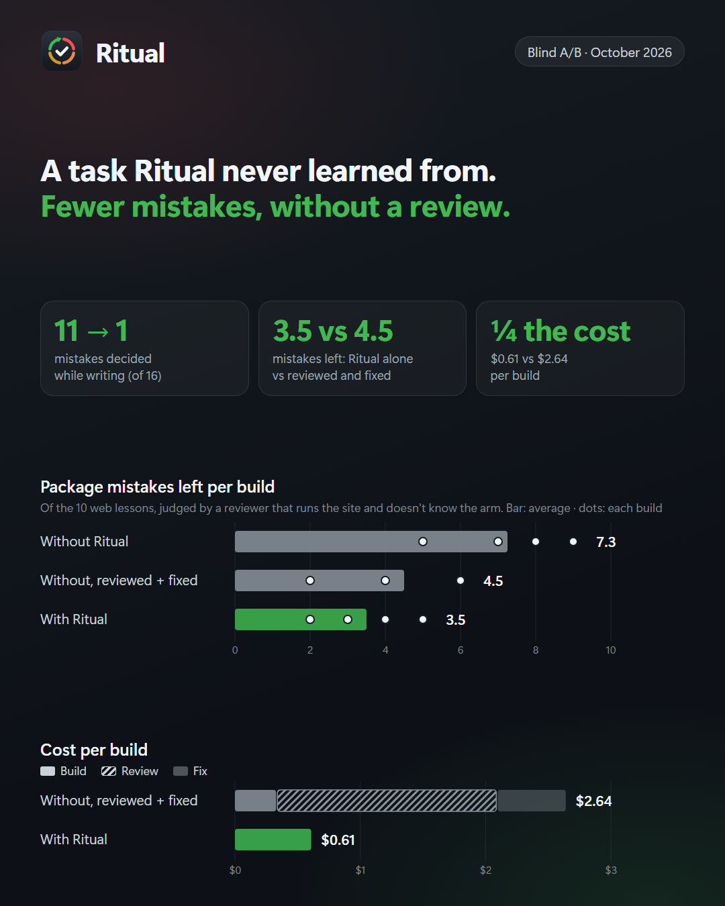

<div align="center">


**Claude se equivoca una vez. Ritual se asegura de que sea la última.**

Un plugin de Claude Code que convierte cada error en una lección, cada lección en una regla y cada regla, cuando puede, en una prueba o una guardia.

[](#install)
[](https://github.com/Zurishadday/Ritual/actions/workflows/test.yml)
[](https://zurishadday.github.io/Ritual/es/)
[](LICENSE)
[](https://github.com/Zurishadday/Ritual/commits/main)

[English](README.md) · **Español** · [Português](README.pt.md) · [Français](README.fr.md) · [中文](README.zh-CN.md) · [日本語](README.ja.md) · [한국어](README.ko.md)

</div>

Otras herramientas anotan lo aprendido; Ritual llega hasta comprobarlo, porque una regla que solo vive en texto se olvida en una sesión larga, y una que se comprueba sola, no.

Trae **54 lecciones de campo**, cada una nacida de un error real; **paquetes por tipo de proyecto**, cuyas lecciones salen de ver a un modelo construir algo y romperse; y **un comando**, `/ritual`, que convierte los errores de tu sesión en lecciones tuyas, y tus lecciones en reglas que se cumplen solas.

<a name="install"></a>

## Instalar

```bash
claude plugin marketplace add Zurishadday/Ritual
claude plugin install ritual@ritual
```

Después, en tu proyecto, escribe `/ritual`. La primera vez averigua qué estás construyendo a partir de tus dependencias y tu README, y te hace una sola pregunta: qué es el proyecto, qué paquetes de lecciones activar y por qué, y en qué idioma. Después crea la carpeta `.ritual/`. Con eso queda todo configurado.

Necesita Node 20.17 o más reciente (`node --version`). Si algo no funciona, escribe `/ritual doctor`: revisa Node, tu configuración y si los hooks realmente se están ejecutando, y te dice qué arreglar.

**Activa la actualización automática una vez.** Llegan lecciones nuevas con frecuencia, y Claude Code deja apagada la actualización automática de los marketplaces que no son de Anthropic. Escribe `/plugin`, abre Marketplaces, elige `ritual` y Enable auto-update. En la app de escritorio, pídele a Claude que «active la actualización automática del marketplace ritual»: Claude agrega `"autoUpdate": true` a la entrada `ritual` de tu `settings.json` de Claude Code. Mientras no lo hagas, Ritual te lo recuerda una vez por semana. Para actualizar a mano: `claude plugin update ritual@ritual`, y luego inicia una sesión nueva.

**¿No se encuentra `claude`?** Eso pasa cuando solo tienes la aplicación de escritorio de Claude, que trae su propia copia. Instala la línea de comandos ([cómo](https://code.claude.com/docs/en/setup)): comparte los plugins con la aplicación. Luego reinicia la aplicación.

## Verlo en acción

Salida real de las pruebas de Ritual, en un proyecto web.

**La guardia bloquea un comando que tu proyecto ya vio fallar,** y dice qué usar en su lugar:

```console
$ git push --force origin main
Ritual guard (force-push-to-main): A forced push to main rewrites shared history. Push to a branch and open a pull request.
```

**La primera vez que Claude edita un componente,** recibe las preguntas detectoras de ese grupo, una vez por sesión (recortadas):

```text
Ritual · Interface and design. Before you continue, run through these detector questions for what you
are about to do. If one applies, act on it and say so in one line; if none applies, just continue.
- 32 · Right after using the control, without moving from where it is, does the user see what changed?
- 45 · If the user does the most likely wrong thing (a typo, an empty answer, two clicks), what do they
       see, and can they keep going?
- WEB-2 · If a thousand fake messages arrive tomorrow, how does the owner find the one real one, and how
          do they delete the rest?
- WEB-4 · After submitting, whether it succeeded or failed, where does focus end up and where does the
          next Tab go?
```

**`/ritual` parte de lo que realmente pasó,** no de la memoria (fragmento):

```text
Log: 1 failed command(s), 1 correction(s), 0 agent report(s)
  10-12 20:05 cmd  npm run build  →  Exit code 1 Type error: Property 'email' does not exist on type 'FormData'
  10-12 20:05 fix  «that is wrong, the form still loses the message»  while Edit src/components/ContactForm.tsx

Guard: 2 block(s) · force-push-to-main ×1, python-c ×1 (details: hooks/guard.mjs --log)

Groups touched in 1 session(s): interface-and-design (1)
```

## Cómo funciona

Cuatro hooks trabajan sin que hagas nada, y un quinto está ahí cuando lo quieras:

| Hook | Qué hace | Qué cuesta |
|---|---|---|
| 📚 **Lecciones del paquete** | Al empezar la sesión, antes de cualquier plan, le da a Claude las lecciones de los paquetes de tu proyecto (web, educación…): lo que suele salir mal en este tipo de proyecto, mientras el diseño todavía puede tenerlo en cuenta. | Una línea por lección del paquete (diez en web), solo con un paquete activo. |
| 🛡️ **Guardia** | Bloquea los comandos que tu proyecto ya vio fallar y dice qué usar en su lugar. Sus reglas viven en `.ritual/guard.json`, cada una con un caso que bloquea y otro que deja pasar. | Nada, hasta que bloquea. |
| 📝 **Bitácora** | Anota en el momento cada comando que falla y cada corrección tuya («eso está mal», «hazlo de nuevo»), con lo que Claude estaba tocando, y el informe de cada agente que corrió en segundo plano. | Nada. |
| ❓ **Preguntas** | La primera vez en la sesión que Claude va a editar una prueba, un componente, un script, un documento o una consulta, o a correr un comando o hacer un commit, le muestra las preguntas detectoras de ese grupo. Una vez por grupo y por sesión. Y en segundo plano, Haiku lee cada petición y la primera escritura de cada archivo y elige, de todos los grupos, las lecciones que aplican, sin las que Claude ya vio. Las de una petición llegan a Claude antes de su primer paso: el paso espera por ellas y, cuando traen algo nuevo, Claude las lee y lo hace de nuevo con ellas. Las de un archivo le llegan en su siguiente paso. Haiku nunca lee tu `.env`, tus claves, certificados ni credenciales, ni archivos fuera del proyecto; todo lo que parezca una clave o una contraseña se oculta antes de salir, y nada de tus peticiones ni de tus archivos se guarda en disco. | Una línea por lección del grupo: hoy, de cuatro a dieciséis según el grupo y los paquetes, y nunca más de veinte, primero las más confirmadas (`"budget"` en `.ritual/config.json` cambia ese límite). Cada elección es una llamada a Haiku a través de tu propio Claude Code, de unos $0.001. Solo el primer paso después de una petición espera: 3 segundos en la mediana, sin espera en el 44% de las peticiones, nunca más de 25 segundos (`"picker": false` lo apaga). |
| ✅ **Cierre** (opcional) | Con `"close": true` en `.ritual/config.json`, la primera vez que Claude va a terminar después de cambiar archivos, lo devuelve una vez para comprobar el trabajo ejecutándolo: las lecciones de tus paquetes y sus verificaciones automáticas, una línea por verificación con lo que corrió. Desactivado por defecto; `/ritual close` lo hace cuando lo pidas. | Una ronda extra por sesión que cambió archivos, cuando está activado. |

Los primeros cuatro solo le ponen enfrente a Claude, en el momento justo, lo que tu proyecto ya aprendió.
**Medido:** en una tarea web de la que Ritual nunca aprendió, se hicieron cuatro construcciones con Ritual y cuatro sin Ritual, y cada una fue revisada a ciegas. Los errores que se deciden mientras se escribe (la ruta de error, el foco del teclado, un archivo de datos dañado) aparecieron 11 veces sin Ritual y una vez con él. Y una construcción con Ritual y sin ninguna revisión no terminó con más errores del paquete que una construcción sin Ritual después de revisión y arreglo (3.5 contra 4.5 en promedio), a una cuarta parte del costo: $0.61 contra $2.64 de construir, revisar y arreglar. Los datos y el método están en [simulaciones](simulations/clinic/RESULTS.md).

<p align="center"><a href="simulations/clinic/RESULTS.md"></a></p>

Con el paquete **web** y el cierre activado, corre `scripts/web-check.mjs` contra el sitio que tienes corriendo en tu máquina: envía el formulario con JavaScript apagado y con el teclado, manda una ráfaga y unos cuantos intentos rechazados, y guarda capturas de teléfono y de escritorio. Solo direcciones locales; dice cuántos mensajes de prueba mandó.

Al cerrar una sesión, o después de un error que dolió, escribe `/ritual`. Lee la bitácora, encuentra qué lección debió atrapar cada error y por qué no saltó, y sube por la escalera: una lección se vuelve regla del guardia o prueba siempre que se pueda.

<details>
<summary><b>Los ocho pasos de <code>/ritual</code></b></summary>

0. Revisa los **candidatos** que el ritual anterior dejó abiertos: lo que pudo volverse prueba y no se volvió.
1. **Lista los errores**, empezando por la bitácora, y confirma la causa de cada uno.
2. Busca **qué lección lo cubría y por qué no saltó**, primero en el grupo del error. Si una lo cubría, afina su pregunta detectora o su señal de alarma, o le agrega el ejemplo.
3. Busca **falsos positivos**: preguntas que hicieron parar sin necesidad y bloqueos del guardia que no tenían razón. Un bloqueo equivocado se vuelve un caso que debe dejar pasar.
4. Escribe una **lección nueva** solo si ninguna lo cubre, con sus cinco partes.
5. **Sube por la escalera** lo que se pueda: un patrón de comando se vuelve regla del guardia; una propiedad del código, una prueba con el nombre de la lección, vista fallar contra el error real antes de confiar en ella; lo que no se puede automatizar y ya se rompió dos veces, una línea en `CLAUDE.md`. Lo demás queda como candidato con su fecha.
6. Guarda todo junto, en el mismo commit, y corre el verificador.
7. Deja los ejemplos anónimos y, si una lección vale para cualquier proyecto, te ofrece el texto para compartirla aquí. Te recuerda las lecciones que aún no has compartido y, cuando la biblioteca acepta una, marca la tuya para que no se muestre dos veces. Nunca publica nada por su cuenta.

</details>

Y `/ritual close` (o `/ritual cierre`), cuando quieras, recorre las preguntas de los grupos que tocaste contra el cambio y te dice qué falta.

## La biblioteca

Las lecciones viven en [`lessons/es/`](lessons/es/README.md), en español; el original está en inglés, en [`lessons/en/`](lessons/en/README.md). Son siete grupos según **lo que estabas haciendo** cuando pasó:

| Grupo | De qué trata |
|---|---|
| Escribir y documentar | Documentación, manuales, textos de pantalla, contenido, prompts. |
| Cifras y datos | Tableros, reportes, modelos, cualquier número que se muestra. |
| Prácticas y pruebas | Pruebas automáticas, validadores, revisiones, calibración. |
| Scripts y archivos | Programas que escriben, generan o transforman archivos y datos. |
| Interfaz y diseño | Pantallas, componentes, estilos, páginas. |
| Consola y herramientas | Comandos, servidores, capturas, y la herramienta que se interpone. |
| Git y proceso | Commits, estados, pendientes, trabajo en paralelo. |

Encima de los grupos van los **paquetes** por tipo de proyecto: lecciones que solo aplican si construyes eso. Viven en el archivo de su grupo, con prefijo (`WEB-1`), y sus preguntas solo aparecen si el paquete está activo. Se activan al arrancar y se pueden cambiar en `.ritual/config.json`.

| Paquete | Lecciones |
|---|---|
| `web` | 5: lo que se pierde cuando se dañan los datos guardados, los robots en un formulario público, el respaldo sin JavaScript, el foco al enviar y un inicio de sesión sin límite de intentos. |
| `education` | 5: un ejercicio que se aprueba sin la habilidad, la respuesta visible antes de la pregunta, dos respuestas defendibles, adivinar por el lugar o el largo, y una pista que regala la respuesta. |
| `apps`, `crm`, `ai` | En camino, con el mismo método. |
| El tuyo | Un tipo de proyecto que falte (móvil, datos, juegos…) empieza con su primera lección: mira [dónde va una lección](lessons/TEMPLATE.md#where-a-lesson-goes). |

Cada lección tiene cinco partes, siempre las cinco: **la idea**, un **ejemplo** real y anónimo, la **pregunta detectora** que separa el caso que aplica del que no, la **señal de alarma** (la frase que uno se dice justo antes de cometerlo otra vez) y **qué hacer**. Y un número que no cambia nunca: una lección que sobra se marca como fusionada en otra, no se borra. El formato completo está en [`lessons/TEMPLATE.md`](lessons/TEMPLATE.md).

> **Un verificador que nunca vio el error no verifica nada.** Una prueba que siempre pasa puede estar rota. La única forma de saberlo es verla fallar contra el error real. *Pregunta detectora:* ¿probé mi verificación contra el error en las formas en que aparecería de verdad? ¿Y contra el caso correcto? *Señal de alarma:* «Ya pasa, entonces está bien puesta».
>
> — lección 13

Ritual aplica esa lección a sí mismo: cada regla del guardia, cada verificador y cada hook de este repositorio lleva sus casos, y se vio fallar antes de entrar.

Cada lección dice de dónde salió y con qué modelo y en qué mes pasó (`field · ~opus · 2026-08`; la `~` quiere decir que es de memoria, no de un registro):

- `field`: de un error real en un proyecto, con ese ejemplo.
- `lab`: se rompió en una [simulación](simulations/README.es.md), y dice qué modelo y cuándo. Pasa a `field` cuando alguien la confirma en un proyecto suyo.
- `proposal`: solo para lo que no «truena» (seguridad), con fuente pública.

> [!NOTE]
> Ritual corre con Claude, y un error que comete un modelo puede no cometerlo otro. Por eso cada lección registra su modelo: una lección que solo pasó con otro modelo se comprueba con Claude antes de que a alguien le salga su pregunta, y cuando un Claude más nuevo ya no comete el error, los datos lo muestran. Consulta [qué modelos cometieron qué errores](lessons/BY-MODEL.md).

## Las lecciones de los paquetes salen de simulaciones

Las lecciones por tipo de proyecto no se inventan. Un modelo construye una tarea realista sin Ritual; otro modelo, en otra sesión, ejecuta lo construido y anota lo que se rompió, con evidencia. Cada tarea se corre dos veces: lo que se rompe las dos veces es lección; lo que se rompe una vez queda como candidato. Cuando sale un modelo nuevo, las tareas se vuelven a correr, y una lección que ya no se rompe se baja con datos. El método y las tareas están en [`simulations/`](simulations/README.es.md).

La primera fue un sitio para un taller de bicicletas con formulario de contacto y página de administración. Sonnet lo construyó dos veces, y las dos versiones escapaban bien el HTML, no salían de la carpeta pública y aguantaron 300 mensajes a la vez. Aun así, las dos perdían en silencio el mensaje que llegaba después de una escritura cortada, las dos aceptaban cientos de mensajes de un robot sin forma de limpiarlos, y una decía que su prueba pasaba cuando fallaba una vez de cada diez. Cada hallazgo está con su evidencia en [`simulations/web/runs/`](simulations/web/runs/2026-10-sonnet-2/FINDINGS.md), junto al código tal como quedó.

La segunda vez la corrió un script ([`scripts/simulate.mjs`](scripts/simulate.mjs)): Sonnet 5.5 construyó en sesiones aisladas y Opus 5.5 revisó. El error de siete de las nueve lecciones de web se repitió en las dos corridas. El error exacto de WEB-1 no, pero su mecanismo sí: en cuanto el archivo de datos se dañaba, cada mensaje nuevo fallaba, así que la lección se afinó en lugar de bajarse. Y apareció un error nuevo en las dos corridas, un acceso de administración sin límite de intentos, que se volvió WEB-5. La comparación está en [el resumen](simulations/web/runs/2026-10-sonnet-5-5-summary.md).

Ritual también se revisa con sus propias lecciones. WEB-1 encontró el mismo error en la bitácora de Ritual, y se corrigió con una prueba que primero se vio fallar.

## Contribuir

La forma más fácil: **confirma una lección**. Si una lección también te pasó a ti, [abre una confirmación](https://github.com/Zurishadday/Ritual/issues/new?template=confirm-a-lesson.yml) con tu ejemplo anónimo y el modelo que usabas. Cada confirmación agrega ese modelo a la lista `seen:` de la lección: así la biblioteca aprende a qué modelos les pasa cada error, y cuáles más nuevos ya no lo cometen. Una lección `lab` o `proposal` con un ejemplo real pasa a `field`, con tu nombre si quieres.

También puedes:

- **Compartir una lección** tuya: escribe `/ritual share`. La compara con la biblioteca (un error que ya está cubierto se vuelve una confirmación, no un duplicado), la reescribe para que le sirva a alguien que construye otra cosa, revisa que no nombre nada de tu proyecto, decide dónde va y abre el [formulario](https://github.com/Zurishadday/Ritual/issues/new?template=share-a-lesson.yml) ya lleno. Tú lo lees y lo envías. Una lección que solo pasó con otro modelo [se comprueba con Claude primero](simulations/README.es.md#cómo-se-revisa-una-lección-que-alguien-aporta).
- **Abrir un paquete nuevo** para un tipo de proyecto que falte: `/ritual share` lo propone cuando una lección no cabe en ninguno de los que existen. O **proponer una tarea de simulación** para él.
- **Revisar una traducción**: las lecciones las traduce un modelo, y cada una lo dice (`by: ai`). Si eres hablante nativo, corrígela y fírmala con tu usuario de GitHub. El flujo está en [`lessons/TRANSLATING.md`](lessons/TRANSLATING.md).
- **Agregar una regla al guardia**, o un caso que debía dejar pasar.

Antes de abrir un pull request, corre `npm test`. Corre la calibración de cada verificador y hook, revisa que cada lección traiga sus cinco partes y que los índices estén al día (`node scripts/lessons.mjs --index` los regenera).

## Idiomas

El original es el inglés. Las lecciones están en siete idiomas: [English](lessons/en/README.md) · [Español](lessons/es/README.md) · [Português](lessons/pt/README.md) · [Français](lessons/fr/README.md) · [中文](lessons/zh-CN/README.md) · [日本語](lessons/ja/README.md) · [한국어](lessons/ko/README.md). Cada traducción dice de qué versión del original salió: cuando el original cambia, el verificador avisa que la traducción quedó vieja.

## Licencia

MIT © 2026 Zurishadday
