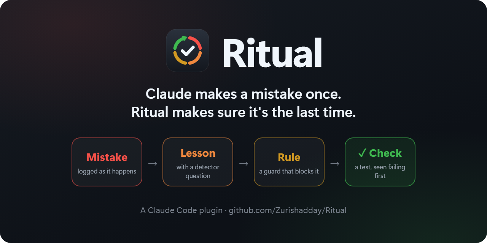

<div align="center">



**Claude se trompe une fois. Ritual veille à ce que ce soit la dernière.**

Un plugin pour Claude Code qui transforme chaque erreur en leçon, chaque leçon en règle, et chaque règle, quand c'est possible, en test ou en garde.

[](#install)
[](https://github.com/Zurishadday/Ritual/actions/workflows/test.yml)
[](https://zurishadday.github.io/Ritual/fr/)
[](LICENSE)
[](https://github.com/Zurishadday/Ritual/commits/main)

[English](README.md) · [Español](README.es.md) · [Português](README.pt.md) · **Français** · [中文](README.zh-CN.md) · [日本語](README.ja.md) · [한국어](README.ko.md)

</div>

D'autres outils notent ce qui a été appris ; Ritual va plus loin et le vérifie, car une règle qui n'existe que sous forme de texte finit par être oubliée au milieu d'une longue session, alors qu'une règle qui se vérifie elle-même ne l'est pas.

Il livre **49 leçons de terrain**, chacune née d'une vraie erreur ; des **paquets par type de projet**, dont les leçons viennent de l'observation d'un modèle en train de construire quelque chose puis de le casser ; et **une seule commande**, `/ritual`, qui transforme les erreurs de votre session en vos propres leçons, et vos leçons en règles qui s'appliquent d'elles-mêmes.

<a name="install"></a>

## Installation

```bash
claude plugin marketplace add Zurishadday/Ritual
claude plugin install ritual@ritual
```

Ensuite, dans votre projet, tapez `/ritual`. La première fois, il détecte ce que vous construisez à partir de vos dépendances, vous pose une seule question (quels paquets de leçons activer, et dans quelle langue) et crée le dossier `.ritual/`. Il n'y a pas d'autre configuration à faire.

Il nécessite Node 20.17 ou une version plus récente (`node --version`). Si quelque chose ne fonctionne pas, tapez `/ritual doctor` : il vérifie Node, votre configuration et si les hooks tournent vraiment, et indique ce qu'il faut corriger.

**Mise à jour.** Ritual s'améliore à chaque commit. Exécutez `claude plugin update ritual@ritual` puis démarrez une nouvelle session, ou activez la mise à jour automatique pour le marketplace `ritual` dans `/plugin` → Marketplaces.

**`claude` introuvable ?** Cela arrive quand vous n'avez que l'application de bureau Claude, qui embarque sa propre copie. Installez la ligne de commande ([comment](https://code.claude.com/docs/en/setup)) : elle partage les plugins avec l'application. Redémarrez ensuite l'application.

## Voir en action

Sortie réelle des tests de Ritual, dans un projet web.

**La garde bloque une commande que votre projet a déjà vu échouer,** et indique quoi faire à la place :

```console
$ git push --force origin main
Ritual guard (force-push-to-main): A forced push to main rewrites shared history. Push to a branch and open a pull request.
```

**La première fois que Claude modifie un composant,** il reçoit les questions détectrices de ce groupe, une fois par session (raccourcies) :

```text
Ritual · Interface and design. Before you continue, run through these detector questions for what you
are about to do. If one applies, act on it and say so in one line; if none applies, just continue.
- 32 · Right after using the control, without moving from where it is, does the user see what changed?
- 45 · If the user does the most likely wrong thing (a typo, an empty answer, two clicks), what do they
       see, and can they keep going?
- WEB-2 · If a thousand fake messages arrive tomorrow, how does the owner find the one real one, and how
          do they delete the rest?
- WEB-4 · After submitting, whether it succeeded or failed, where does focus end up and where does the
          next Tab go?
```

**`/ritual` part de ce qui s'est réellement passé,** et non de la mémoire (extrait) :

```text
Log: 1 failed command(s), 1 correction(s)
  10-12 20:05 cmd  npm run build  →  Exit code 1 Type error: Property 'email' does not exist on type 'FormData'
  10-12 20:05 fix  «that is wrong, the form still loses the message»  while Edit src/components/ContactForm.tsx

Guard: 2 block(s) · force-push-to-main ×1, python-c ×1 (details: hooks/guard.mjs --log)

Groups touched in 1 session(s): interface-and-design (1)
```

## Fonctionnement

Trois hooks fonctionnent sans que vous ayez rien à faire :

| Hook | Ce qu'il fait | Ce que ça coûte |
|---|---|---|
| 🛡️ **Garde** | Bloque les commandes que votre projet a déjà vu échouer, et indique quoi utiliser à la place. Ses règles se trouvent dans `.ritual/guard.json`, chacune avec un cas qu'elle bloque et un cas qu'elle laisse passer. | Rien, tant qu'elle ne bloque pas. |
| 📝 **Journal** | Enregistre, au fil de l'eau, chaque commande qui échoue et chaque correction de votre part (« c'est faux », « refais-le »), avec ce que Claude était en train de toucher. | Rien. |
| ❓ **Questions** | La première fois dans une session que Claude s'apprête à modifier un test, un composant, un script, un document ou une requête, ou à lancer une commande ou à faire un commit, il lui montre les questions détectrices de ce groupe. Une fois par groupe et par session. | Une ligne par leçon du groupe, de trois à treize selon le groupe et les paquets. |

Rien de cela ne change ce que fait Claude : il place seulement devant lui, au bon moment, ce que votre projet a déjà appris.

Quand vous fermez une session, ou après une erreur qui a fait mal, tapez `/ritual`. Il lit le journal, trouve quelle leçon aurait dû attraper chaque erreur et pourquoi elle ne l'a pas fait, puis monte l'échelle : une leçon devient une règle de garde ou un test chaque fois que c'est possible.

<details>
<summary><b>Les huit étapes de <code>/ritual</code></b></summary>

0. Examine les **candidats** laissés ouverts par le rituel précédent : ce qui aurait pu devenir un test et ne l'est pas devenu.
1. **Liste les erreurs**, en commençant par le journal, et confirme la cause de chacune.
2. Cherche **quelle leçon la couvrait et pourquoi elle ne s'est pas déclenchée**, d'abord dans le groupe de l'erreur. Si l'une la couvrait, il affine sa question détectrice ou son signal d'alarme, ou ajoute l'exemple.
3. Cherche les **faux positifs** : les questions qui ont fait s'arrêter Claude pour rien, et les blocages de la garde qui étaient erronés. Un blocage erroné devient un cas que la règle doit laisser passer.
4. Écrit une **nouvelle leçon** seulement si aucune ne couvre le cas, avec ses cinq parties.
5. **Monte l'échelle** là où c'est possible : un motif de commande devient une règle de garde ; une propriété du code, ou un test qui porte le nom de la leçon, vu échouer face à la vraie erreur avant qu'on lui fasse confiance ; ce qui ne peut pas être automatisé et a déjà cassé deux fois, une ligne dans `CLAUDE.md`. Le reste reste un candidat daté.
6. Enregistre tout ensemble, dans le même commit, et lance le vérificateur.
7. Garde les exemples anonymes et, si une leçon vaut pour n'importe quel projet, vous propose le texte à partager ici. Il ne publie jamais rien de lui-même.

</details>

Et `/ritual close`, avant de déclarer quelque chose terminé, parcourt les questions des groupes que vous avez touchés face au changement, et vous indique ce qui manque.

## La bibliothèque

Les leçons se trouvent dans [`lessons/fr/`](lessons/fr/README.md) (l'original est en anglais, dans [`lessons/en/`](lessons/en/README.md)), réparties en sept groupes selon **ce que vous faisiez** au moment où c'est arrivé :

| Groupe | Ce qu'il couvre |
|---|---|
| Écriture et documentation | Documentation, manuels, textes d'écran, contenus, prompts. |
| Chiffres et données | Tableaux de bord, rapports, modèles, tout chiffre affiché. |
| Tests et vérifications | Tests automatisés, validateurs, relectures, calibrage. |
| Scripts et fichiers | Programmes qui écrivent, génèrent ou transforment des fichiers et des données. |
| Interface et design | Écrans, composants, styles, pages. |
| Console et outils | Commandes, serveurs, captures, et l'outil qui gêne. |
| Git et processus | Commits, états, éléments en attente, travail parallèle. |

Au-dessus des groupes se trouvent les **paquets** par type de projet : des leçons qui ne s'appliquent que si vous construisez ce type de projet. Ils vivent dans le fichier de leur groupe avec un préfixe (`WEB-1`), et leurs questions n'apparaissent que si le paquet est activé. Ils sont activés à l'installation et peuvent être modifiés dans `.ritual/config.json`.

| Paquet | Leçons |
|---|---|
| `web` | 4 : ce qui se perd après une écriture interrompue, les robots sur un formulaire public, le repli sans JavaScript, et le focus sur l'envoi. |
| `apps`, `crm`, `ai` | En préparation, avec la même méthode. |
| Le vôtre | Un type de projet qui manque (mobile, données, jeux…) commence par sa première leçon : voir [où va une leçon](lessons/TEMPLATE.md#where-a-lesson-goes). |

Chaque leçon a cinq parties, toujours les cinq : **l'idée**, un **exemple** réel et anonyme, la **question détectrice** qui sépare le cas qui s'applique de celui qui ne s'applique pas, le **signal d'alarme** (la phrase que vous vous dites juste avant de refaire l'erreur) et **que faire**. Et un numéro qui ne change jamais : une leçon redondante est marquée comme fusionnée dans une autre, jamais supprimée. Le format complet se trouve dans [`lessons/TEMPLATE.md`](lessons/TEMPLATE.md).

> **Un contrôle qui n'a jamais vu l'erreur ne vérifie rien.** Un test qui réussit toujours peut être cassé. La seule façon de le savoir est de le voir échouer face à la vraie erreur. *Question détectrice :* ai-je testé mon contrôle face à l'erreur dans les formes où elle apparaîtrait réellement ? Et face au cas correct ? *Signal d'alarme :* « Il réussit déjà, donc il est bien configuré. »
>
> — leçon 13

Ritual applique cette leçon à lui-même : chaque règle de garde, chaque contrôle et chaque hook de ce dépôt porte ses cas, et a été vu échouer avant d'être publié.

Chacune indique son origine, ainsi que le modèle et le mois où elle s'est produite (`field · ~opus · 2026-08` ; le `~` signifie qu'elle vient de la mémoire, et non d'un enregistrement) :

- `field` : une vraie erreur dans un projet, avec cet exemple.
- `lab` : elle a cassé dans une [simulation](simulations/README.fr.md), et indique quel modèle et quand. Elle devient `field` lorsque quelqu'un la confirme dans son propre projet.
- `proposal` : seulement pour ce qui ne casse pas de façon visible (la sécurité), avec une source publique.

> [!NOTE]
> Ritual tourne sur Claude, et une erreur qu'un modèle commet peut ne pas être commise par un autre. C'est pourquoi chaque leçon note son modèle : une leçon qui ne s'est produite qu'avec un autre modèle est vérifiée avec Claude avant que quiconque reçoive sa question, et quand un Claude plus récent ne commet plus l'erreur, les données le montrent. Voir [quels modèles ont commis quelles erreurs](lessons/BY-MODEL.md).

## Les leçons des paquets viennent de simulations

Les leçons par type de projet ne sont pas inventées. Un modèle construit une tâche réaliste sans Ritual ; un autre modèle, dans une autre session, fait tourner ce qui a été construit et note ce qui a cassé, avec des preuves. Chaque tâche est exécutée deux fois : ce qui casse les deux fois est une leçon ; ce qui ne casse qu'une fois reste un candidat. Quand un nouveau modèle sort, les tâches sont relancées, et une leçon qui ne casse plus est rétrogradée, avec des données à l'appui. La méthode se trouve dans [`simulations/`](simulations/README.fr.md).

La première était un site pour un atelier de réparation de vélos, avec un formulaire de contact et une page d'administration. Sonnet l'a construit deux fois. Les deux versions échappaient correctement le HTML, gardaient les requêtes dans le dossier public et tenaient face à 300 messages à la fois. Malgré cela, les deux perdaient en silence le message arrivé après une écriture interrompue, les deux acceptaient des centaines de messages venant d'un robot sans aucun moyen de les nettoyer, et l'une affirmait que son test passait alors qu'il échouait une fois sur dix. Chaque constat, avec ses preuves, se trouve dans [`simulations/web/runs/`](simulations/web/runs/2026-10-sonnet-2/FINDINGS.md), à côté du code tel qu'il a été laissé.

Ritual est aussi vérifié avec ses propres leçons. WEB-1 a trouvé le même bug dans le journal de Ritual lui-même, et il a été corrigé avec un test vu échouer d'abord.

## Contribuer

La façon la plus simple : **confirmer une leçon**. Si une leçon vous est aussi arrivée, [ouvrez une demande de confirmation](https://github.com/Zurishadday/Ritual/issues/new?template=confirm-a-lesson.yml) avec votre exemple anonyme et le modèle que vous utilisiez. Chaque confirmation ajoute ce modèle à la liste `seen:` de la leçon : la bibliothèque apprend ainsi à quels modèles une erreur s'applique, et quels modèles plus récents ne la commettent plus. Une leçon `lab` ou `proposal` accompagnée d'un exemple réel devient `field`, avec votre nom si vous le souhaitez.

Vous pouvez aussi :

- **Partager une leçon** de la vôtre : écrivez `/ritual share`. La commande la compare à la bibliothèque (une erreur déjà couverte devient une confirmation, pas un doublon), la réécrit pour qu'elle serve à quelqu'un qui construit autre chose, vérifie qu'elle ne nomme rien de votre projet, décide où elle va et ouvre le [formulaire](https://github.com/Zurishadday/Ritual/issues/new?template=share-a-lesson.yml) déjà rempli. Vous la relisez et l'envoyez. Une leçon qui ne s'est produite qu'avec un autre modèle est [vérifiée avec Claude d'abord](simulations/README.fr.md#vérifier-une-leçon-contribuée).
- **Ouvrir un nouveau paquet** pour un type de projet qui manque : `/ritual share` en propose un lorsqu'une leçon ne rentre dans aucun de ceux qui existent. Ou **proposer une tâche de simulation** pour lui.
- **Relire une traduction** : les leçons sont traduites par un modèle, et chacune l'indique (`by: ai`). Si vous êtes locuteur natif, corrigez-la et signez-la avec votre nom d'utilisateur GitHub. La procédure se trouve dans [`lessons/TRANSLATING.md`](lessons/TRANSLATING.md).
- **Ajouter une règle de garde**, ou un cas qu'elle aurait dû laisser passer.

Avant d'ouvrir une pull request, lancez `npm test`. Il lance le calibrage de chaque vérificateur et de chaque hook, vérifie que chaque leçon a ses cinq parties et que les index sont à jour (`node scripts/lessons.mjs --index` les régénère).

## Langues

L'anglais est l'original. Les leçons existent en sept langues : [English](lessons/en/README.md) · [Español](lessons/es/README.md) · [Português](lessons/pt/README.md) · [Français](lessons/fr/README.md) · [中文](lessons/zh-CN/README.md) · [日本語](lessons/ja/README.md) · [한국어](lessons/ko/README.md). Chaque traduction indique de quelle version de l'original elle provient : quand l'original change, le vérificateur avertit que la traduction est périmée.

## Licence

MIT © 2026 Zurishadday
